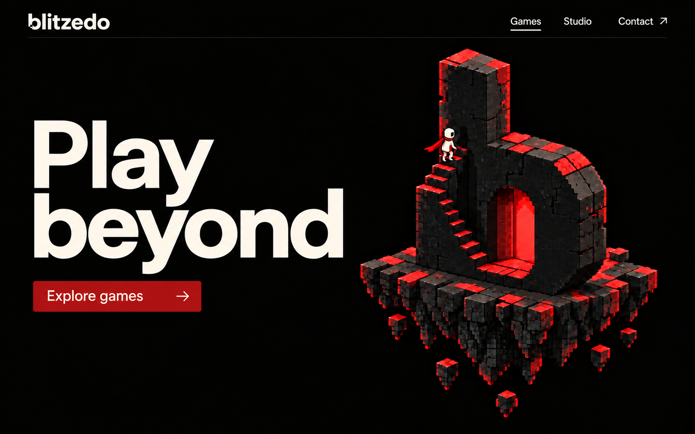
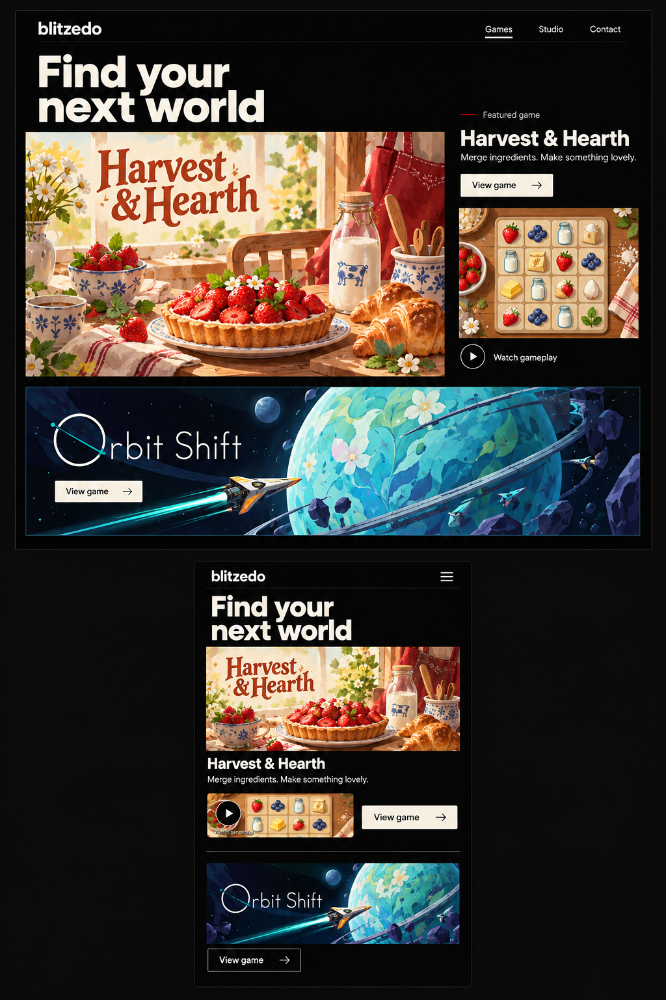
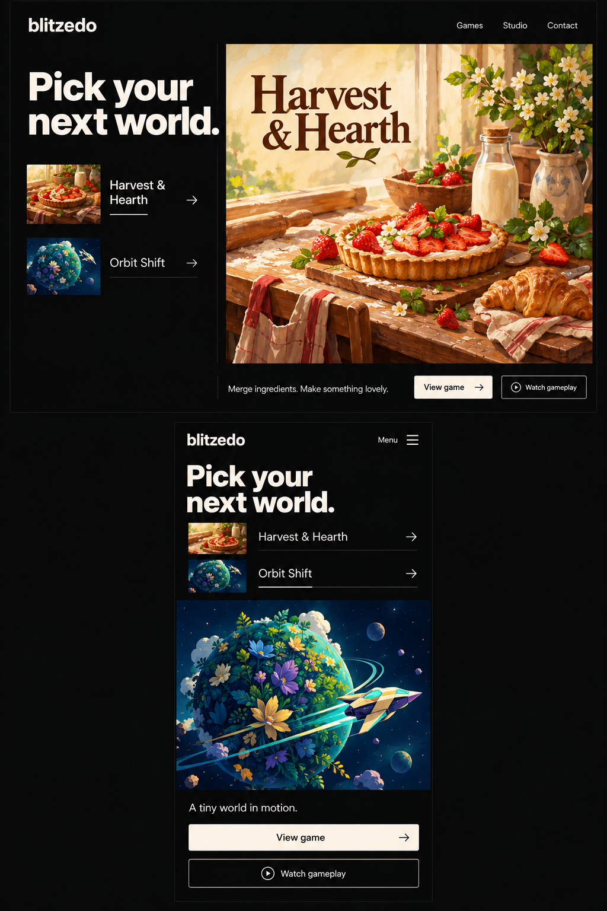
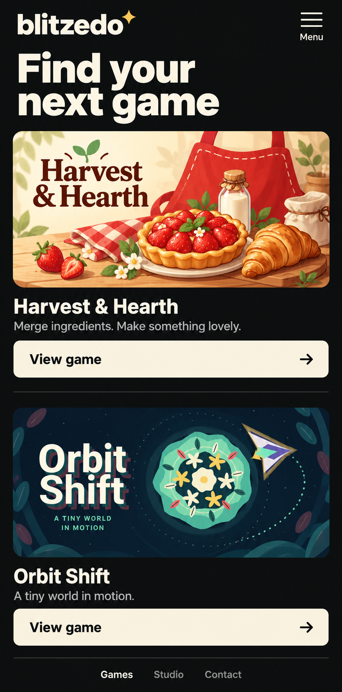
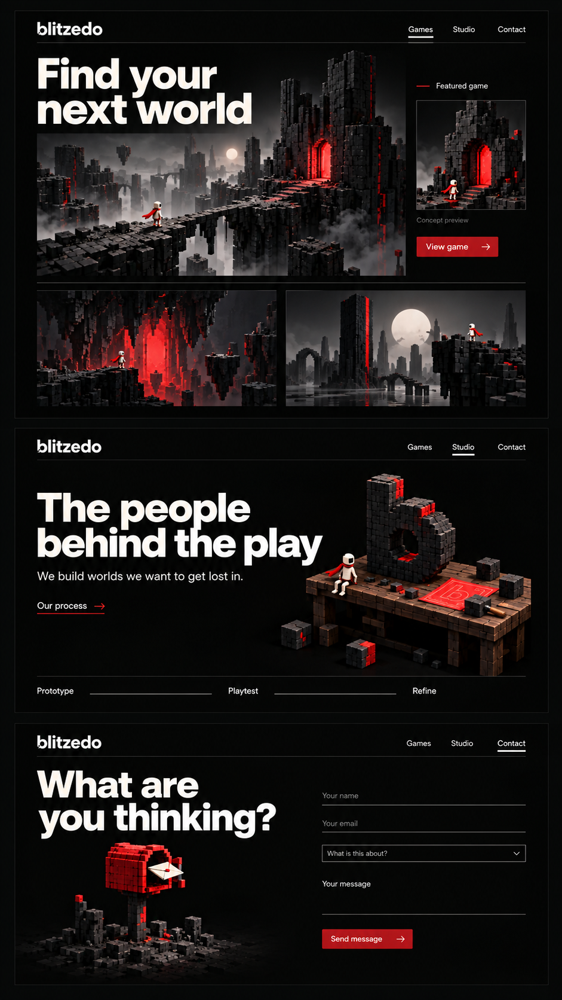
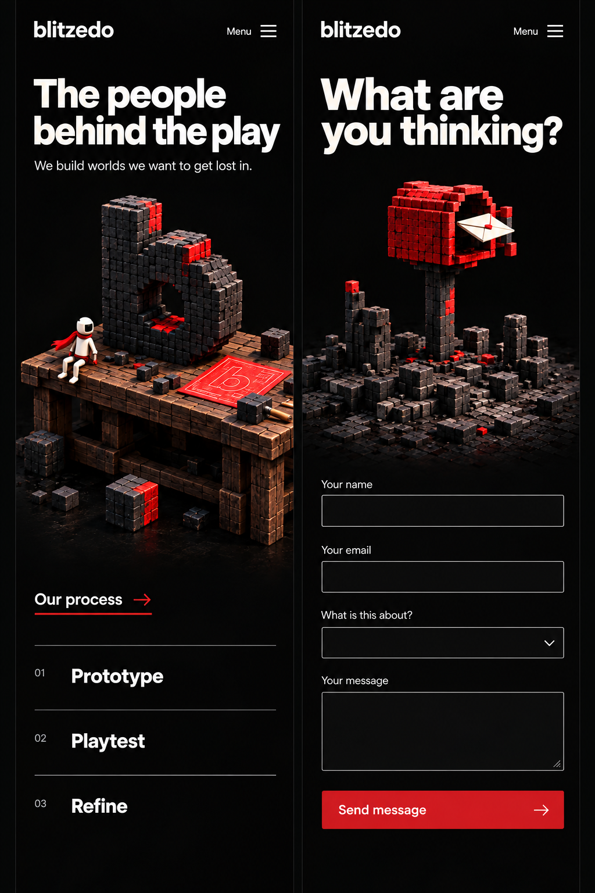
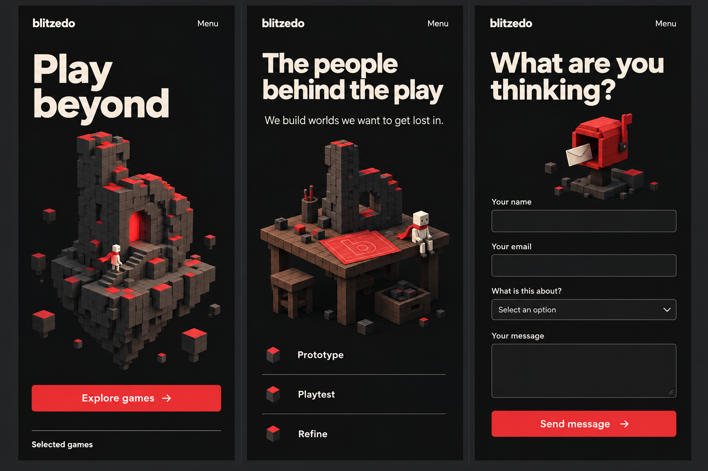

# Blitzedo website design

Design foundation · 15 October 2026 · Version 0.1

This document captures the direction developed through concept exploration. It is the starting point for design iteration, then website implementation, then animation and mascot development. This repository currently contains documentation and reference images only.

**The idea:** a restrained, confident studio website with a small, distinctive world inside it. Large ivory typography, charcoal surfaces, selective red, and finely built voxel artwork give Blitzedo its identity. Each game keeps its own visual personality.

## Decision status

| Area | Status | What this means |
| --- | --- | --- |
| Home: Play beyond | Approved direction | Preserve composition, typography character, floating b architecture and red balance. |
| Desktop Studio and Contact | Approved direction | Preserve the workbench and mailbox scenes; refine practical UI details. |
| Mobile | Refinement underway | Adapt layout while preserving the original artwork's detail. |
| Games | Exploring | Two newer layout proposals are documented below; neither is a final user selection. |
| Game posters | Separate future asset work | Mockup posters illustrate layout, not final art direction. |
| Motion and mascot | Later proposals | Build the static experience first; do not treat animation ideas as implemented. |

Written decisions in this document take precedence over incidental text, symbols or layout errors in generated mockups. Approved direction does not imply that every generated pixel is a production specification.

## Home: the visual anchor

Keep the short headline **Play beyond**, with no decorative full stop. A single primary action, **Explore games**, leads to the games collection. The lowercase blitzedo wordmark sits in a quiet header with Games, Studio and Contact links.

The focal artwork is a lowercase b assembled from small charcoal voxel blocks, with a red doorway, a stairway, a floating rocky foundation and a tiny ivory explorer wearing a red scarf. Keep the fine block construction and balance of black, grey and red. Do not replace the sculpture with a generic letter, a chunky toy or a much busier landscape.

Desktop uses a generous left text area and right artwork area. On mobile, put the headline and action within easy reach, then give the same artwork enough space to read clearly. Final crop and order should be reviewed on narrow screens before approval.

## Visual system

| Element | Direction |
| --- | --- |
| Background | Near-black; generous empty space and very little decorative texture. |
| Text | Warm ivory primary text; readable muted secondary text. |
| Red | Clearly present in the portal, scarf, selected sculpture surfaces and primary actions. It should not cover every surface. |
| Typography | Large, tightly composed bold sans headings; simple readable UI and body text. Exact font remains to be chosen and licensed. |
| Logo | Clean lowercase wordmark; refine the b silhouette and spacing. No added sparkle or decorative punctuation. |
| Layout | Strong alignment, thin rules, asymmetric desktop compositions and calm spacing. |
| Buttons | Clear labels, restrained corners and purposeful arrows. Consistent dimensions and visible interaction states. |
| Copy | One strong heading, a short useful line when necessary and a clear next action. |

Provisional implementation palette, to validate later: background `#090A08`, charcoal `#20211F`, ivory `#F4F0E6`, red `#D51D22`. These are suggested starting values, not sampled or approved exact colors. Verify text contrast when the UI is built.

Avoid repeated decorative cards, glass effects, unnecessary gradients, full-screen red washes, arbitrary badges and numbered 01/02 concept markers. Detail belongs in the focal artwork; the surrounding interface stays quiet.

## Page structure

| Destination | Purpose | Main content and action |
| --- | --- | --- |
| Home | Introduce Blitzedo | Play beyond hero, selected games, short studio introduction. |
| Games | Help visitors choose a game | Distinct game artwork, title, short description, gameplay preview and View game. |
| Individual game | Explain that game | Native visual identity, actual footage/screenshots, brief premise and verified play/store links. |
| Studio | Show the people and process | Workbench scene, short introduction and Prototype / Playtest / Refine. |
| Contact | Start a conversation | Mailbox scene and a concise accessible form. |

The header remains consistent between pages. The active indicator reflects the actual current page; the Games underline visible in the home concept is not a rule for Home. The wordmark links home. Do not invent release dates, platforms, review scores, team biographies or store availability.

## Games: one studio, distinct worlds

The website frame remains recognizably Blitzedo. Inside the artwork area, each game keeps its own colors, typography and illustration style. Do not tint every game red or reconstruct every poster in voxels.

### Option A: editorial feature

A large featured poster is paired with a compact title, short description, action and separate gameplay preview. A second game gets a generous strip below. Mobile stacks those elements in reading order.

This gives the flagship game prominence and keeps gameplay visible alongside promotional art. It needs a deliberate featured-game choice so the second title does not feel forgotten.

### Option B: selectable showcase

**Recommended for the next design pass, pending user selection.** A short list of named games controls one large artwork stage. Both game choices are immediately visible. The selected game has a title, one useful sentence and View game / Watch gameplay actions.

On desktop, selection sits beside the large stage. On mobile, both selectors sit above it, with actions below. Choosing a game updates the stage without moving the navigation or unexpectedly scrolling the page. Reserve a stable media area to prevent layout jumps. Do not auto-cycle the selected game.

Watch gameplay can replace the poster with a user-started video in the same stage, with an obvious return-to-poster control. View game opens its dedicated page. If footage is not available, omit Watch gameplay rather than showing a dead control.

### Earlier stacked mobile exploration

Useful fallback for a simple collection: one generous game card per row. The generated logo sparkle is not part of the brand. This layout is retained as an alternative, not as the final choice.

### Correct art treatment for the two games

| Game | Preserve | Website treatment |
| --- | --- | --- |
| Harvest & Hearth | Cream, warm red, blue stitching, food illustrations, cozy serif lettering and ingredient-board clarity. | A warm poster within the neutral site frame; show a real board screenshot separately. |
| Orbit Shift | Navy/teal, mint and yellow accents, a simple graphic floral planet and angular ship. | A spacious dark poster with the game's own shapes; avoid turning it into detailed cinematic sci-fi. |

The generated poster scenes in Options A and B are **layout placeholders**. They drift toward elaborate painterly food scenes and more complex space imagery than the real games. Future posters will be designed separately and must match the real gameplay. Browser/status bars in the supplied references are screenshot context, not intended poster content.

See the [actual game screenshots](design/game-references/README.md) before designing replacement posters.

## Studio and Contact: preserve the original scenes

The top Games scene is an earlier atmospheric exploration, not a claim that a red-portal game exists. Studio and Contact in this board are the approved visual direction.

### Studio

**The people behind the play**

A detailed wooden voxel workbench supports an unfinished b sculpture, loose blocks, tools and a red technical drawing. The explorer sits naturally within that scene. Preserve the material detail without filling the whole background.

Short supporting copy: “We build worlds we want to get lost in.” The process is Prototype / Playtest / Refine. Each step can later reveal one concrete example from real work; do not create fictional production stories. A prototype-to-final comparison is an optional future feature when genuine assets exist.

### Contact

**What are you thinking?**

Keep the small-brick red mailbox, ivory envelope, dark post, broken columns and carefully arranged rubble. The surrounding diorama is part of the approved composition, not disposable decoration.

Form fields: name, email, topic and message. Use visible labels, a clear Send message action and understandable validation. Topic choices remain to be defined from actual contact needs. Show a delivery confirmation only after the backend confirms success; an animation must never imply that an unsent message was delivered.

## Mobile: same world, responsive composition

This refinement brings back detail lost in the earlier mobile attempt. It is a reference for composition, not a replacement master asset. The numbered process markers appearing in it should be removed.

- Reuse the approved artwork across breakpoints. Change scale, framing and surrounding layout; do not independently redraw a simpler mobile version.
- Preserve the mailbox's rubble, columns, envelope and fine block texture. Give the contact scene its own visible space before the form.
- Preserve the workbench tools, red drawing, loose blocks and small explorer.
- Use a compact wordmark and an obvious Menu control. The menu must expose Games, Studio and Contact without requiring a decorative interaction.
- Stack the contact form in one column with generous input heights and readable labels.
- Keep game selectors visible and touch-friendly. Do not rely on hover to expose essential actions.
- Avoid horizontal page overflow. Let the page grow vertically instead of shrinking everything to fit one viewport.

Suggested build-time review widths: 360, 390, 768 and 1440 pixels. These are testing targets, not locked breakpoints. Aim for touch controls around 44 pixels tall, keyboard navigation, visible focus and meaningful text alternatives.

Earlier mobile reference — artwork simplification rejected

Retained to explain the iteration. Do not use its simplified geometry as the final artwork target.

## Motion proposals for a later phase

| Trigger | Proposed response | Boundary |
| --- | --- | --- |
| Explore games | A short doorway-inspired reveal into the Games page. | Navigation should remain immediate and usable without the effect. |
| Choose a game | Brief poster crossfade; selection state updates clearly. | No automatic cycling or layout jump. |
| View game | Carry the selected artwork into the detail-page header. | Normal navigation remains the fallback. |
| Button hover/focus | Small arrow movement and clear color/focus response. | No cursor chasing or unreliable moving target. |
| Contact success | Envelope settles into the mailbox. | Run only after successful delivery. |
| Optional explorer idle | Small scarf movement or occasional glance. | Quiet, infrequent and non-blocking. |

Initial timing exploration: roughly 200–400 ms for UI transitions. Respect reduced-motion preferences, keep scrolling natural and avoid mandatory cinematic intros. On mobile, prioritize fast media loading and stable layout. All motion above is proposed, not implemented.

## Mascot direction

The existing ivory explorer with a red scarf is the continuity anchor. Start by defining its silhouette, proportions and a few expressions from the approved scene. Later, test a short idle, a welcoming gesture and a mailbox interaction. Keep it as a small companion to the content; no floating assistant panel or constant interruption is currently approved.

## Next design decisions

1. Select the Games layout: editorial feature or selectable showcase.
2. Refine that layout with posters faithful to the real games and real gameplay screenshots.
3. Lock the mobile Home composition using the approved b artwork.
4. Refine the wordmark, exact font, button states and form layout.
5. Approve static desktop and mobile screens before starting website code.
6. Build the website, then add purposeful transitions, then develop the mascot.

Use the [iteration checklist](design/ITERATION.md) to record future approvals. Keep original concept files intact; add new revisions with clear names and update the status here.
