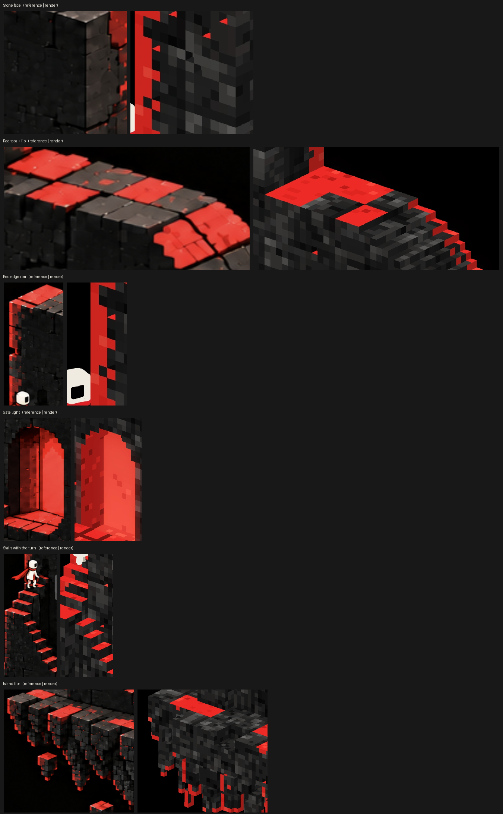
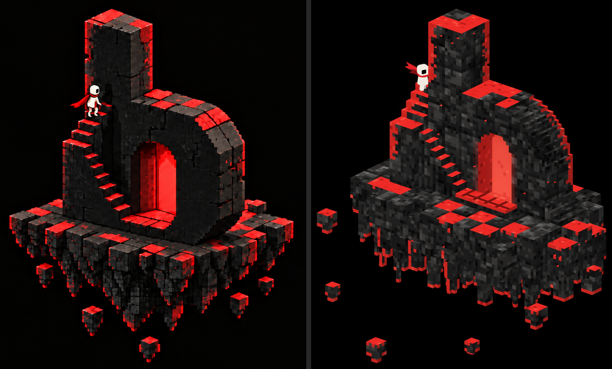

# The b sculpture: pixel-art voxel method

How the home page sculpture (`assets/sculpture.webp`) is built, and how each part is matched to the detail references in
[`references/sculpture/`](references/sculpture/). The character (the explorer) is out of scope here.





## Method

- Generator: `tools/sculpture-vox.js` (three.js), rendered headless by `tools/build-sculpture.js`.
- Everything is a **voxel grid**. One voxel is **2.5 units**, so a 15-unit big block is **6 × 6 × 6 voxels**. The voxels are
  deliberately chunky: each voxel face is one visible pixel of the texture.
- Every visible voxel face is a flat-coloured quad. There are no lights, gradients or shadow maps: shading is baked per
  face orientation, which is what gives the crisp pixel-art look.
- Only faces pointing at the camera (+X right, +Y front, +Z top) are built.
- Camera: orthographic, 40° around from the b's face, 24° up.

## Palette

| Use | Colour |
| --- | --- |
| Stone, base (front faces) | `#202020`–`#2a2a2a` |
| Stone chips (lighter 2 × 2 clusters) | `#383838`–`#454545` |
| Stone pits | `#141414` |
| Red, main (lit tops, rims, treads) | `#ED2B26` |
| Red, variants | `#E0241F` (darker), `#FA4538` (highlight), `#BD1A17` (rare dark) |
| Gate back wall | `#EB4033`, with rare `#F54D3D` / `#D62E26` pixels |
| Gate side wall (jamb) | `#A31A17`, with `#7A120F` specks |
| Gate floor and threshold | `#E6382E`, with `#FA5442` pixels |
| Small doorway | `#0D0B0B` (near black, no glow) |

## Texture rules

**Stone (every block face)**
- Each block has its own tone (±0.015) so neighbouring blocks differ slightly.
- Inside a face (strong grain): about 24 % lighter 2 × 2 chips, 14 % light flecks, 12 % dark pits, 18 % darker 3 × 3
  patches, plus a soft low-frequency variation.
- Face shading: top × 1.5, front × 1.0, right × 0.74, so tops read as lighter grey and right faces as darkest.
- Seams: where the block changes inside a face, the lower or right edge pixel is darkened (× 0.72) and the upper or left
  edge is lit (× 1.16). This draws the dark cracks and lit bevels between big blocks.
- Contact shadow: a top face directly in front of a taller wall is darkened × 0.7.

**Red light (painted, the way the reference does it)**
- Letter tops: a checker of big blocks, red and dark, with about 20 % swapped so it never looks mechanical.
- Island tops: the same checker per island block. Stair treads, tower tops and loose cubes: always red.
- Lip: on the island and loose cubes a red top sometimes wraps one pixel down the sides (25 %); never on the letter, tower or
  stairs, so the red outline is always followed by black below.
- **Outline, not dots** (the key rule): a face pixel is red only where its edge borders the background, i.e. the shape's
  silhouette from the camera. The generator checks each voxel edge: if the neighbour cell is empty and the view ray behind
  it (away from the camera) never meets stone, the edge is on the outline. Inner edges stay black. So the b reads as a red
  outline around a black body, the island's underside is black with a red silhouette and red tips, and the stairs and tower
  are red along their outer edges, not on their fronts.
- Band width: on the letter, tower and stairs the outline is 1 voxel always, 2 often, 3 sometimes (a ragged inner edge), broken
  now and then by noise along the edge; on the island it is 1 voxel, sometimes 2.
- No random red specks anywhere.

**The gate (the red light is different here)**
- The gate is an arched opening recessed one big block. The arch is a semicircle cut on the voxel grid, so it comes out
  as a stepped pixel arch, as in the reference.
- Colour comes from where a face looks into the recess: the back wall (front-facing) is a flat glowing coral; the left
  inner wall (right-facing) is a darker red with specks; the floor is red tiles.
- The light spills a little: the stone frame's lowest pixels next to the opening take a red tint. A two-row red
  threshold sits outside, and a soft halo is added only around the glowing pixels.

## Stairs: the path

They start at the gate and end at a small doorway in the stem:

1. **Gate step**: a raised platform of red tiles (with dark joints) in front of the gate only; its front is black stone below a
   red lip. The stairs start from it.
2. **Lower flight**: 8 steps (5 run, 5 rise) climb left along the stem's front to the tower.
3. **Mid landing**: the front of the tower at the b's front-left, 45 high, with red rims on its edges. The stairs turn here.
4. **Upper flight**: 3 steps climb back toward the stem.
5. **Top landing**: 65 high, beside the stem's front-left corner.
6. **Small doorway**: a dark arched recess cut into the stem at the top landing, which the stairs end in.

Treads are red; risers are dark stone.

## Island

- Each top block hangs as its **own column**: it tapers in jagged steps (5, 4, 3, 2, 1 voxels wide, 3–5 voxels per step,
  chipped corners), so neighbouring columns are separated by black gaps, as in the reference.
- Red under the island: **only three light lines**, each the left front edge of one front-row column under the stairs and
  gate, running the full height of the column; plus the bottom edge of every tip. Every other underside edge is black.
- Rough surface: random one-voxel dents in the side faces (7 % on the island, 2.5 % on the b).

- A slab of big blocks with a rounded-rectangle outline; the odd edge block sits lower.
- Each block hangs into 2 × 2 half-block columns. Their depth follows a cone that is deepest under the middle. Under each
  column hang 2 × 2 quarter-block tips, 1–4 long, with red bottoms.
- Six loose cubes float around the island, with red tops and a small tip below each.

## The b

- **Stem**: 30 × 30 × 120.
- **Bowl**: 90 long, 30 deep, 75 high. Its right end is two big blocks; its top-right curve has radius 45 and is cut
  voxel by voxel so it reads round. At the bottom of its right end the bowl's foot flares out in a black concave curve that merges into the island; no light falls
  there. The curved
  shoulder carries red only at its front and back edges.
- **Gate**: 30 wide, a 37.5-high rectangle under a radius-15 arch.

## Rebuild

```sh
cd tools && npm install && cd ..
CHROMIUM_PATH=/opt/pw-browsers/chromium node tools/build-sculpture.js
```

Then update the `` `width` and `height` in `index.html` to the printed size.

## Where it still differs from the reference (≈ 80 %)

- The reference's stone has finer grain inside each pixel. Ours is one flat colour per voxel, because the voxel size is
  kept chunky on purpose.
- The bowl's curve is rounder and smoother in the reference.
- The reference's island columns are more clearly separated, with gaps between them.
- The upper flight is partly hidden behind the tower from this camera.
