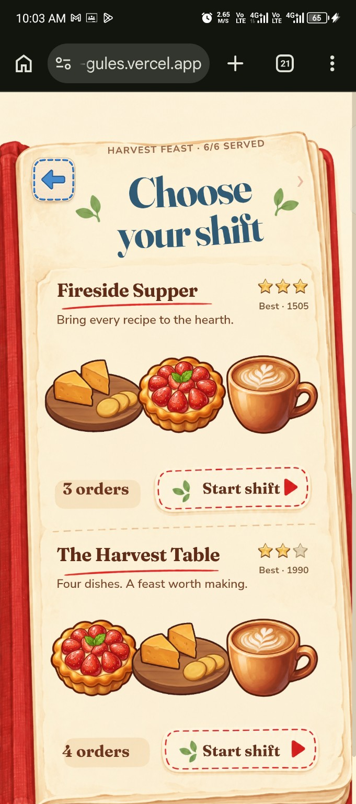
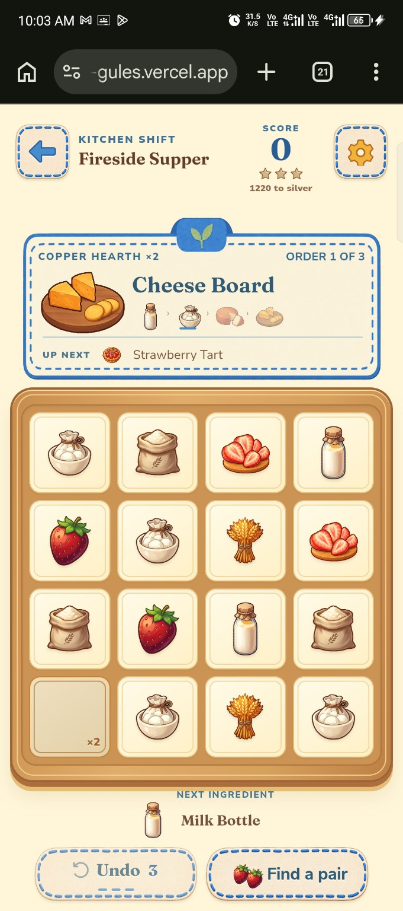
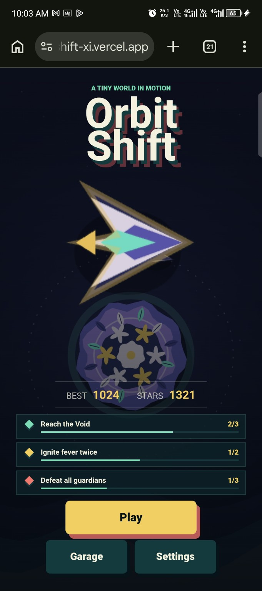
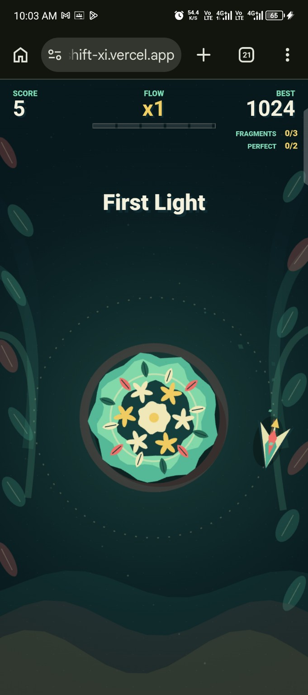

# Actual game references

User-supplied screenshots of the two games. These establish each game's visual identity and gameplay appearance. Browser and phone chrome are screenshot context and should not appear in final posters.

## Harvest & Hearth

Keep the cream background, warm red, blue stitching, food illustrations, cozy serif lettering, and clear ingredient board.

## Orbit Shift

Keep the navy and teal palette, mint and yellow accents, graphic floral planet, and angular ship. Avoid replacing its simple shapes with elaborate cinematic space imagery.

