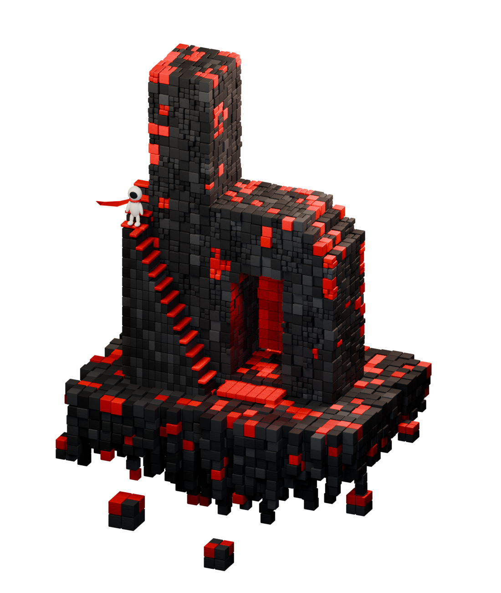
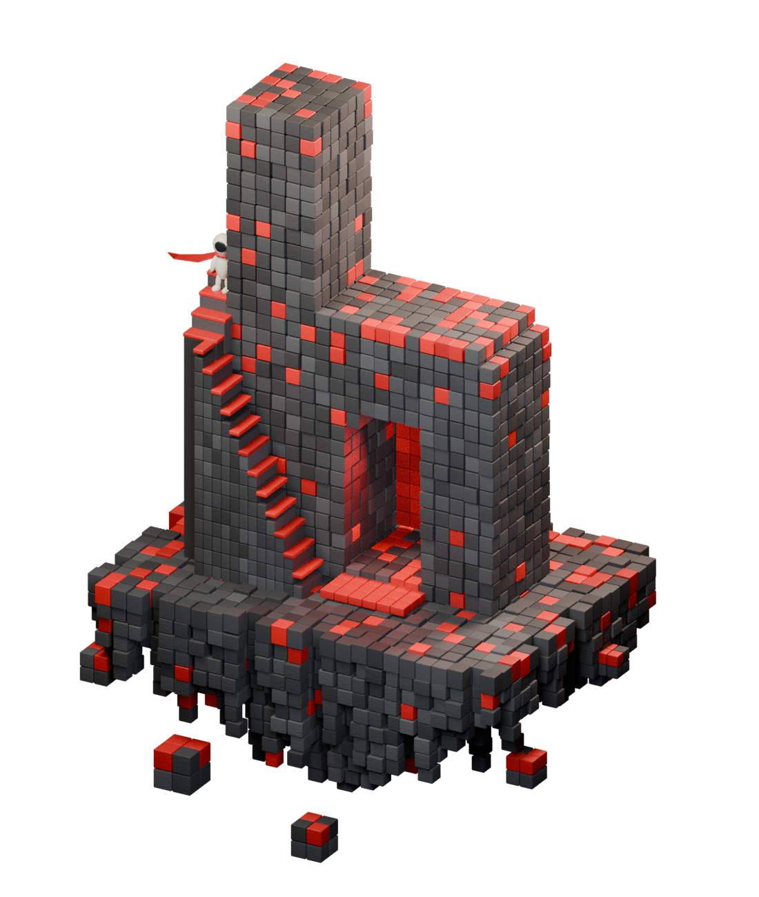

# Home island renders

First Blender studies based on [the approved Home reference](../design/concepts/home-play-beyond-approved.png). These are work in progress, not final approved artwork.

## Latest — version 2

Finer masonry, darker basalt, a rounder stepped shoulder, and a more visible explorer. The foundation outline, portal lighting, and explorer details still need refinement.

## Initial — version 1

