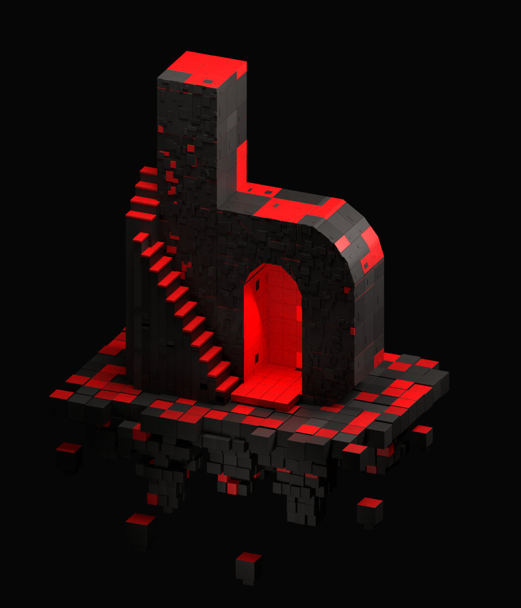
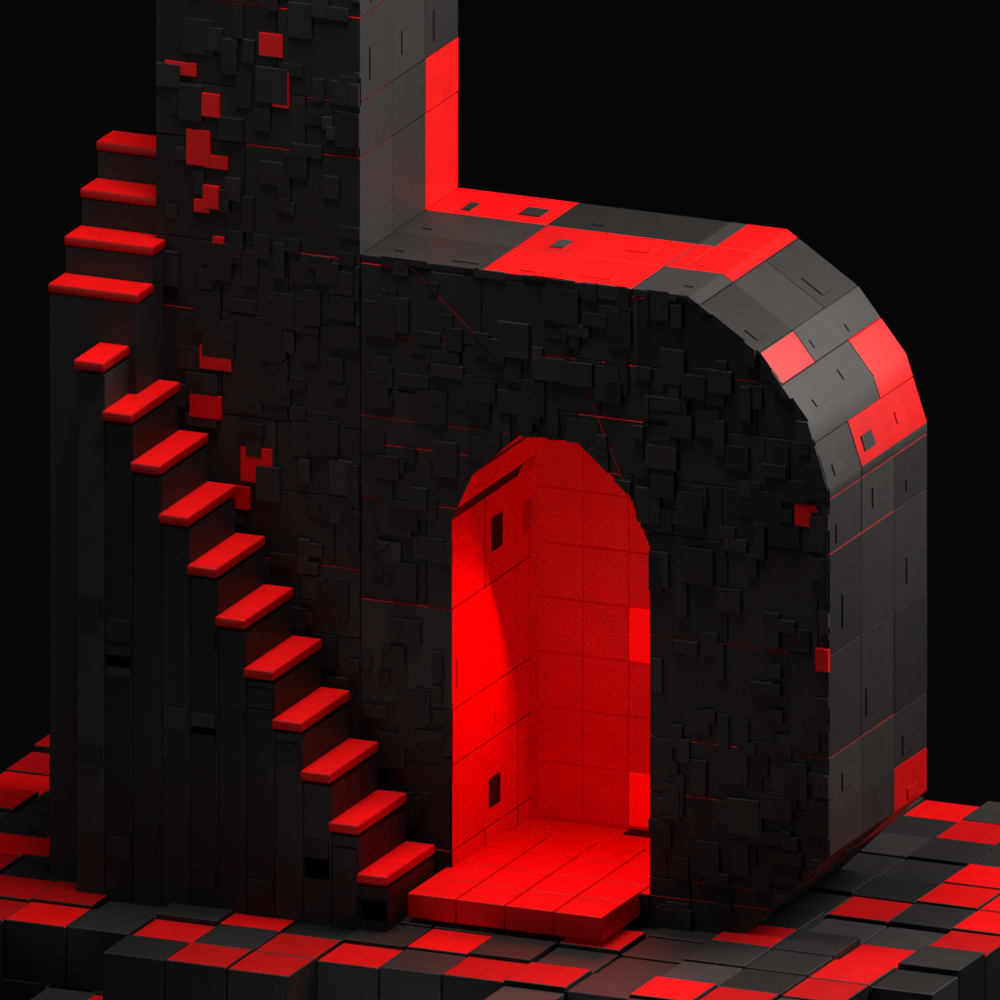

# Home island renders

First Blender studies based on [the approved Home reference](../design/concepts/home-play-beyond-approved.png). These are work in progress, not final approved artwork.

## Latest — version 4

Rebuilt against the approved Home image and the user's Tripo close-ups. The character remains omitted at the user's request.

- Continuous faceted bowl silhouette and arched doorway, rather than a staircase-shaped outer curve.
- Tightly fitted blocks with varied widths and shallow pixel relief. Reduced coarse grain and prominent mortar gaps.
- Dark front faces, brighter top/side facets, and red concentrated on treads, selected upper surfaces, and the illuminated interior.
- Clustered hanging rock instead of a uniform row of block columns.

### Doorway, masonry, and lighting close-up

### Compare with the previous result

| Version 3 | Version 4 |
| --- | --- |
|  |  |

[Open the approved Home reference](../design/concepts/home-play-beyond-approved.png).

| Reference requirement | Version 4 response | Still different |
| --- | --- | --- |
| Dark charcoal front with readable detail | Reduced fill; tight seams and shallow rectangular surface relief | Reference masonry is more irregular and chipped |
| Thick rounded bowl, red arch interior | Continuous polygonal shoulder, arched cutout, recessed red lining and light | Exact curvature and opening proportions are approximate |
| Selective red upper surfaces and stair treads | Per-face red materials and a separate portal light | Red patch placement and luminance are not an exact match |
| Fractured floating foundation | Overlapping tapering clusters with smaller tips | The reference's individual rock clusters are not reproduced exactly |

[Reproducible Blender generator](../tools/build_home_island.py). Run with Blender 4.3: `blender -b -t 8 --python tools/build_home_island.py -- --export`. The script creates the scene, exchange model, and renders locally. Procedural materials still require baking for equivalent browser rendering.

Version 3 departed from the reference through its regular grid, coarse surface grain, stepped shoulder, and broadly lit grey faces. Version 4 addresses those specific differences. This is still a reconstruction: the exact block arrangement, rock silhouette, and lighting are not a pixel-for-pixel match. The reference's character is deliberately excluded by the newer user instruction.

## Earlier — version 3

Character removed. Larger masonry blocks without tiny subdivisions, enlarged foundation blocks, textured basalt, and red surfaces with pigment variation, pitting, and worn dark flecks. The detail view below shows the material treatment more closely.

### Material close-up

## Earlier — version 2

Finer masonry, darker basalt, a rounder stepped shoulder, and a more visible explorer. The foundation outline, portal lighting, and explorer details still need refinement.

## Initial — version 1

