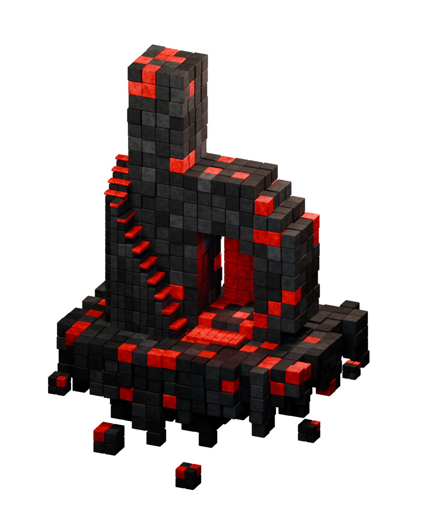
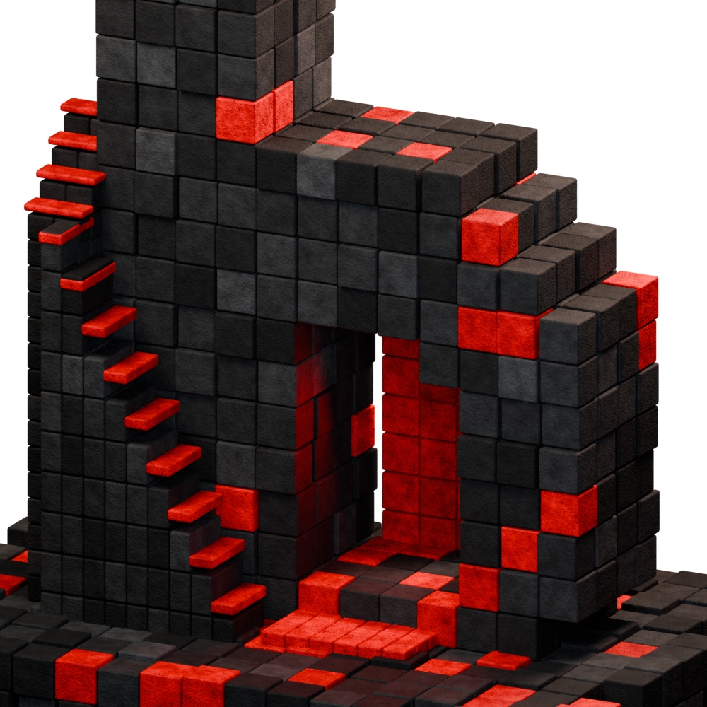

# Home island renders

First Blender studies based on [the approved Home reference](../design/concepts/home-play-beyond-approved.png). These are work in progress, not final approved artwork.

## Latest — version 3

Character removed. Larger masonry blocks without tiny subdivisions, enlarged foundation blocks, textured basalt, and red surfaces with pigment variation, pitting, and worn dark flecks. The detail view below shows the material treatment more closely.

### Material close-up

## Earlier — version 2

Finer masonry, darker basalt, a rounder stepped shoulder, and a more visible explorer. The foundation outline, portal lighting, and explorer details still need refinement.

## Initial — version 1

